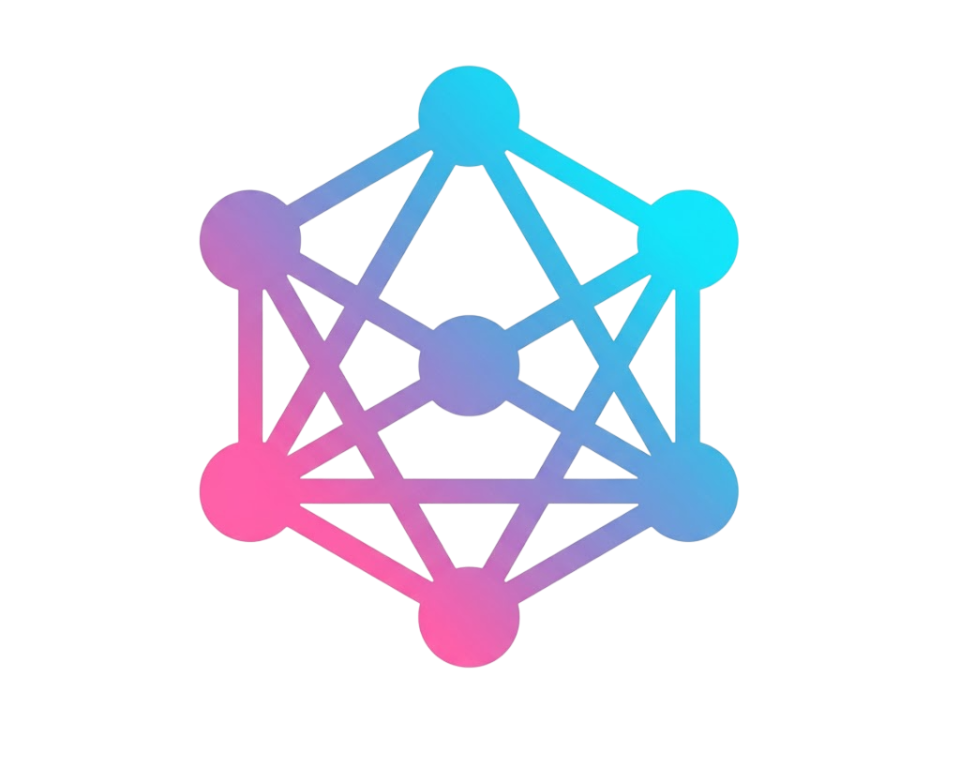

# AXION Core

<p align="center">
  
</p>

<p align="center">
  <strong>A local Lua script execution and client integration hub.</strong>
</p>

AXION Core is a desktop application that connects compatible clients to user-defined Lua functions. It provides a local execution layer where clients can request data inspection, evaluate conditions, and receive results that determine how their workflows should proceed.

Instead of embedding every data check and decision into the client, developers can define reusable functions in AXION's Server Scripts and invoke them whenever additional processing is needed.

## How It Works

AXION uses a **Request–Process–Response** workflow:

1. **Request** — The client calls a named Server Script function through the AXION API and can provide parameters.
2. **Execute** — AXION runs the corresponding Lua function using its embedded Lua runtime.
3. **Process** — The function inspects available information, searches data, evaluates conditions, or performs other logic defined by the developer.
4. **Respond** — The function returns a result to the client.
5. **Continue the workflow** — The client uses the result to decide what to do next, such as continuing, waiting, calling another function, or skipping a task.

This separation lets developers change processing logic in Server Scripts without placing every operation directly inside the client. The client remains responsible for deciding how to proceed based on the returned result.

## Features

- **Custom Server Scripts** — Define reusable Lua functions that clients can invoke.
- **Data inspection** — Search and evaluate workspace and inventory information available to AXION.
- **Conditional workflows** — Let client-side logic choose subsequent actions based on function results.
- **Local WebSocket service** — Handle client connections, status updates, logs, and workspace data.
- **HTTP API** — Provide an interface for invoking Server Script functions.
- **Client monitoring** — View connected clients and their available information.
- **Console and logging** — Search and filter application, client, and script activity.
- **Desktop interface** — Manage scripts, inspect data, and monitor runtime activity in one place.
- **Localization** — Includes English, Thai, and Vietnamese interface translations.

## Architecture

AXION Core currently operates as a **local desktop application**. Its primary services run on the same machine as the connected client; it is not a hosted central server or cloud-based orchestration service.

| Component | Responsibility |
| --- | --- |
| Desktop UI | Script management, data inspection, settings, and monitoring |
| Tauri / Rust backend | Native application services and local communication |
| WebSocket service | Client connectivity, status updates, logs, and workspace data |
| Server Scripts runtime | Executes user-defined Lua functions |
| HTTP API | Provides an interface for invoking Server Script functions |
| Lua client API | Provides client-side integration with AXION |

## Tech Stack

- React 18 and TypeScript
- Vite 5
- Tauri 2
- Rust (2021 edition)
- Wasmoon for running Lua Server Scripts
- Lua client API
- Vitest for frontend tests

## Requirements

- Node.js 18.x or 20+, as supported by the project dependencies
- npm
- Rust stable toolchain with Cargo
- On Windows: Microsoft C++ Build Tools and WebView2 prerequisites required by Tauri

See the [Tauri prerequisites guide](https://v2.tauri.app/start/prerequisites/) for platform-specific setup instructions.

## Installation

Clone or download the repository, then open a terminal in the project root and install the locked dependencies:

```sh
npm ci
```

## Development

### Run the desktop application

```sh
npm run tauri -- dev
```

This starts the Tauri desktop application and its native backend services.

### Run the frontend only

```sh
npm run dev
```

This starts the Vite development server for frontend development. It does **not** start the native WebSocket or Server Scripts services, so features that depend on those services will not work normally.

### Run tests and checks

Frontend tests:

```sh
npm test
```

TypeScript check:

```sh
npm run typecheck
```

Rust tests:

```sh
cargo test --manifest-path src-tauri/Cargo.toml
```

## Build

Build the frontend:

```sh
npm run build
```

Vite writes the frontend output to `dist/`.

Build the Tauri desktop application:

```sh
npm run tauri -- build
```

The native release output is placed under `src-tauri/target/release/`.

> **Note:** Bundling is disabled in the current configuration, so this command does not generate an installer package.

## Configuration

A `.env` file is not required for the normal desktop workflow.

| Setting | Default |
| --- | --- |
| Client WebSocket address | `127.0.0.1:5242` |
| Server Scripts HTTP API port | `5243` |

Both ports can be changed in **Server Scripts**. After changing the WebSocket port, use **Copy AXION API** and reconnect clients using the copied client API.

The Lua client configuration is located at:

```text
lua/AXION api.lua
```

The application stores workspace and locale data in its Tauri application data directory. Task and script UI data use local storage.

## Project Structure

```text
.
├── config/
│   └── locales/          # Shipped translation catalogs
├── docs/                 # Client, WebSocket, workspace, and Server Scripts API docs
├── lua/                  # Lua client API and related scripts
├── public/               # Static frontend assets
├── scripts/              # Development helpers, including the Tauri CLI wrapper
├── src/
│   ├── components/       # Application pages and UI components
│   ├── data/             # UI data types and fixtures
│   ├── i18n/             # Frontend localization
│   ├── lua-api/          # Core API and runtime foundation
│   ├── services/         # Frontend services and persistence
│   └── axion/             # Modular task and system development foundation
├── src-tauri/
│   ├── capabilities/     # Tauri permissions
│   └── src/              # Rust application and local service implementation
├── package.json
├── package-lock.json
├── vite.config.ts
└── README.md
```

## Design Principles

- **Separation of concerns:** Server Scripts handle custom processing logic; the client controls what happens next.
- **Reusable functions:** The same named function can be invoked at different points in a workflow.
- **Flexible decision-making:** Functions return results that clients can use to choose between different actions.
- **Local-first execution:** The current architecture runs its primary services on the local machine.

## Project Status

AXION Core is under active development. The API, runtime, desktop interface, and integration capabilities may change as the project evolves.

For implementation details and supported API behavior, refer to the documentation in the `docs/` directory.

## License

MIT License

Copyright (c) 2026 AXION Core contributors

Permission is hereby granted, free of charge, to any person obtaining a copy
of this software and associated documentation files (the "Software"), to deal
in the Software without restriction, including without limitation the rights
to use, copy, modify, merge, publish, distribute, sublicense, and/or sell
copies of the Software, and to permit persons to whom the Software is
furnished to do so, subject to the following conditions:

The above copyright notice and this permission notice shall be included in all
copies or substantial portions of the Software.

THE SOFTWARE IS PROVIDED "AS IS", WITHOUT WARRANTY OF ANY KIND, EXPRESS OR
IMPLIED, INCLUDING BUT NOT LIMITED TO THE WARRANTIES OF MERCHANTABILITY,
FITNESS FOR A PARTICULAR PURPOSE AND NONINFRINGEMENT. IN NO EVENT SHALL THE
AUTHORS OR COPYRIGHT HOLDERS BE LIABLE FOR ANY CLAIM, DAMAGES OR OTHER
LIABILITY, WHETHER IN AN ACTION OF CONTRACT, TORT OR OTHERWISE, ARISING FROM,
OUT OF OR IN CONNECTION WITH THE SOFTWARE OR THE USE OR OTHER DEALINGS IN THE
SOFTWARE.
